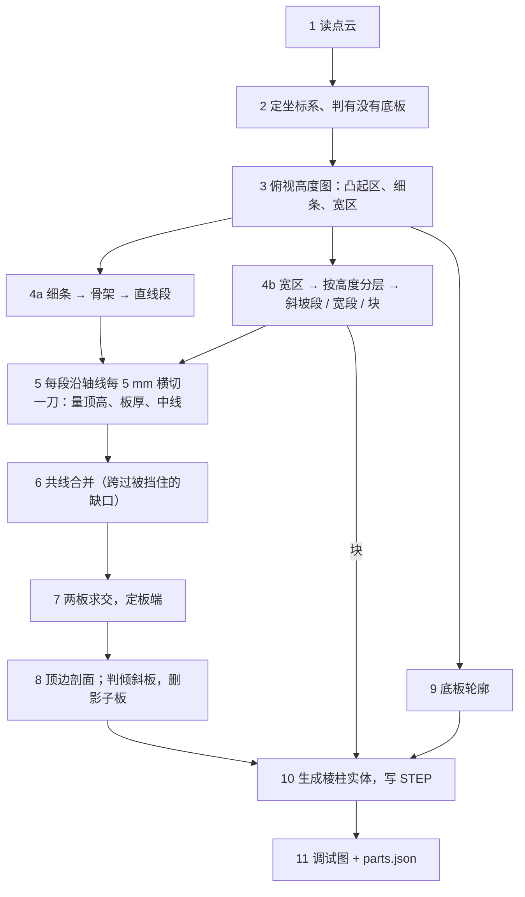
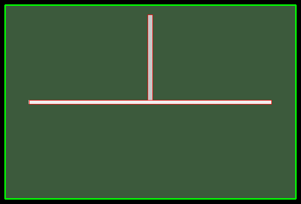

# 02 核心思路与流程总览

> 读完这一章，你应该能回答：程序分几步？每一步吃进什么、吐出什么？在代码的哪一段？
> 后面第 03 ~ 09 章会把每一步拆开细讲，这一章先给一张"地图"。

## 1. 一句话原理

**俯视高度图负责"分块"**（哪里有板、板往哪个方向走），**垂直于板轴线的横切片负责"量尺寸"**（顶高、厚度、中线），**两块板的交线负责"定板端"**；看不到的面，用"看得到的面 + 板厚"补出来。

再压缩成一句：**面靠拟合，边靠交线，看不到的面靠厚度补。**

为什么这样想：

- 从上往下扫，能扫清楚的只有"大平面"（底板）和"立板顶上那一条窄条"（宽度就是板厚）。立板的侧面、背面、根部大多看不到。
- 点云里最不准的是边缘上的点（飞点、混合像素、遮挡都集中在边上），最准的是面中间的点（几百上千个点一平均，噪声就没了）。
- 所以不去"描边"，而是先把看得清的东西量准，再用几何关系把看不清的边算出来。

更完整的设计讨论见附录 [设计思路原稿](design_rationale.md)。

## 2. 模型怎么表示：每个零件都是一个"棱柱"

焊接件就是一块块板焊在一起。程序输出的每个零件都是一个**棱柱**：一个平面多边形，沿一个方向拉伸一段距离。

| 零件 | 多边形画在哪里 | 往哪个方向拉伸 | 拉多长 |
|---|---|---|---|
| 竖直立板 | 板的一个侧面上（侧视轮廓 = 底边 + 顶边剖面） | 水平，垂直于板面 | 板厚 |
| 倾斜板 | 拟合出来的那个斜侧面上 | 斜面的水平法向 | 板厚 ÷ cosθ |
| 块（厚块、抬高的平板） | 块的底面（俯视轮廓） | 竖直向上 | 块高 |
| 底板 | 底板的下表面（俯视轮廓） | 竖直向上 | 底板厚 |

**不做布尔合并**，每块板是一个独立实体。这样又快又不容易出错，而且焊接件本来就是一块块板。

## 3. 两种工件：有底板、无底板

- **有底板**：底板是最低、最大的平面，立板都站在它上面。z = 0 就定在底板顶面，板底都是 z = 0。
- **无底板**（例如桁架）：找不到这样的底板。z = 0 定在工件最低处附近，每块板的板底要从点云里量。

两种工件走**同一条流程**，只有两处不同：z = 0 怎么定（第 2 步），板底在哪（第 5 步）。

## 4. 11 步流程



| 步 | 做什么 | 输入 → 输出 | 代码位置 | 详解 |
|---|---|---|---|---|
| 1 | 读点云，去掉 NaN/Inf | `.pcd` → 点 `P`（N×3，原坐标） | `tools/proto_v2.py` 第 56–57 行，`tools/read_any_pcd.py` | [03](03_frame.md) |
| 2 | 找真正的"上"，判有没有底板，建工件坐标系 | `P` → 工件坐标点 `Q`、坐标轴 `E`、原点 `o`、`has_base`、`base_t` | `tools/proto_v2.py` 第 58–63 行，`tools/protolib.py` 第 97–228 行 | [03](03_frame.md) |
| 3 | 选像素大小，做俯视高度图，分出凸起区、细条、宽区 | `Q` → `hm`、`occ`、`base_vis`、`raised`、`thin`、`wide` | `tools/proto_v2.py` 第 66–107 行，`tools/protolib.py` 第 231–241 行 | [04](04_heightmap.md) |
| 4 | 细条求骨架、断成直线段；宽区按高度分层，再分成斜坡段、宽段、块 | `thin`、`wide` → 段 `segs`、块 `blobs` | `tools/proto_v2.py` 第 110–194 行，`tools/protolib.py` 第 249–297 行 | [05](05_segments.md) |
| 5 | 每段沿轴线每 5 mm 横切一刀，量顶高、顶面宽、顶面中心 | `segs` + 点 → 板 `plates` | `tools/proto_v2.py` 第 197–264 行 | [06](06_slices.md) |
| 6 | 共线的几段并成一块板，再重新拟合 | `plates` → 更少、更长的 `plates` | `tools/proto_v2.py` 第 267–310 行 | [07](07_merge_junctions.md) |
| 7 | 板端：和相交的板求交线，顶到对方侧面 | 改每块板的 `s0`、`s1` | `tools/proto_v2.py` 第 312–338 行 | [07](07_merge_junctions.md) |
| 8 | 顶边剖面（斜顶、缺口）；判倾斜板；删掉斜板的"影子" | 每块板加 `prof`，部分板加 `lean` | `tools/proto_v2.py` 第 341–495 行 | [08](08_profile_lean.md) |
| 9 | 底板轮廓（矩形或多边形） | `base_vis`、`raised` → `base_poly` | `tools/proto_v2.py` 第 497–514 行 | [09](09_solids_output.md) |
| 10 | 生成棱柱实体，转回原坐标，写 STEP | 板、块、底板 → `solids` → `model.step` | `tools/proto_v2.py` 第 517–565 行，`tools/step_writer.py` | [09](09_solids_output.md) |
| 11 | 画调试图，写 parts.json，屏幕打印一行 JSON | → `debug_top.png`、`parts.json` | `tools/proto_v2.py` 第 567–598 行 | [09](09_solids_output.md)、[10](10_outputs.md) |

## 5. 核心数据：一块"板"长什么样

第 5 步以后，每块板是一个字典（dict）。所有量都在**工件坐标**里（见下一节），单位 mm。

```
俯视（xy 平面）:

                    nrm = perp(d)  (d 逆时针转 90 度)
                     ^
     s = s0          |                   s = s1
       +-------------|---------------------+   ---
       |             c ---------> d        |    w (板厚 = 顶面条带的宽)
       +-----------------------------------+   ---

侧视（沿 nrm 方向看，横轴 s、纵轴 z）:

   z
   ^          顶边剖面 prof（可以是斜的、有台阶）
   |       +-----------------------+
   |       |                        \
   |       |                         +
   |       |                         |
   +-------+-------------------------+-----> s
          s0     底边 z = bottom      s1
```

| 键 | 含义 |
|---|---|
| `c` | 板中线上的一个点（xy） |
| `d` | 板的方向（xy 单位向量）。板上的点 = `c + d·s` |
| `s0`、`s1` | 板的起点、终点在 `d` 方向上的位置。板长 = `s1 − s0` |
| `w` | 板厚（= 俯视看到的顶面条带的宽度） |
| `bins` | 每个 5 mm 切片的 (切片中心 s, 顶高) |
| `bottom` | 板底的 z：有底板时是 0，无底板时从点云里量 |
| `src` | 这块板是从哪来的：`thin`（细条）、`wide`（宽区里的长条）、`slope`（斜坡带） |
| `level` | 只有 `wide` 来的板才有：所在高度层的高度 |
| `n_top`、`n_slices`、`w_iqr` | 顶面点数、有效切片数、切片宽度的四分位距（离散程度） |
| `prof` | 第 8 步算的顶边剖面：一串 (s, z) |
| `lean` | 第 8 步判成倾斜板时才有：斜面的平面方程、倾角、厚度等 |
| `joints` | 第 7 步找到交线的那些端（`"s0"` / `"s1"`） |

`perp(d)` 就是把 `d` 逆时针转 90°（`tools/proto_v2.py` 第 39–40 行）。

**为什么用 (c, d, s0, s1) 而不是"两个端点"？** 因为后面大量的计算都是"沿板方向走多远""离中线多远"，用中线 + 方向表示最顺手：一个点 `p` 在这块板上的位置就是 `s = (p − c)·d`，离中线的距离就是 `v = (p − c)·nrm`。第 5 步的切片、第 7 步的交线都是这样算的。

## 6. 坐标系约定

| 名字 | 是什么 |
|---|---|
| 原坐标 | 点云文件里的坐标，单位 mm。传感器的 +Z 大致朝上（指向相机），但不完全垂直于底板 |
| 工件坐标 | `ez` = 真正的"上"（有底板时就是底板平面的法向）；`ex` = 工件的长边方向；`ey = ez × ex` |
| `E` | 3×3 矩阵，三行依次是 `ex`、`ey`、`ez` |
| `o` | 工件坐标原点在原坐标里的位置 |
| 原坐标 → 工件坐标 | `Q = (P − o)·Eᵀ` |
| 工件坐标 → 原坐标 | `P = Q·E + o`（`to_world`，`tools/proto_v2.py` 第 518–519 行） |
| z = 0 | 有底板：底板顶面；无底板：大约是工件最低处（全部点 z 的 0.5% 分位） |

输出的 STEP 会**转回原坐标**，这样它和点云、参考模型能直接叠在一起看。

高度图的像素和 mm 的换算：列号 `col` 对应 x，行号 `row` 对应 y，像素中心的坐标是 `x = x0 + (col + 0.5)·px`，`y = y0 + (row + 0.5)·px`（`to_mm`，`tools/protolib.py` 第 244–246 行）。

## 7. 代码怎么读

- `tools/proto_v2.py` 是一个**从上往下顺序执行的脚本**，没有 `main()`。每一步开头都有一行形如 `# ---------------------------------------------------------------- 5 逐段切片拟合每块板` 的分隔注释，搜 `# ----` 就能在步骤之间跳。
- 可以反复用的函数放在 `tools/protolib.py`：坐标系（`detect_frame`）、高度图（`heightmap`）、骨架分段（`skeleton_segments`）、多边形清理（`simple_ring`）。
- 读点云在 `tools/read_any_pcd.py`，写 STEP 在 `tools/step_writer.py`，这两个可以先当黑盒。
- 脚本里的几个"全局变量"会贯穿全程，记住它们读代码会轻松很多：

| 变量 | 第几步产生 | 是什么 |
|---|---|---|
| `Q` | 2 | 工件坐标里的全部点（N×3） |
| `has_base`、`base_t` | 2 | 有没有底板；底板厚 |
| `px` | 3 | 高度图一个像素多少 mm |
| `hm`、`occ`、`base_vis` | 3 | 高度图；哪些像素有点；哪些像素看得到底板 |
| `raised`、`thin`、`wide` | 3 | 凸起区；细条；宽区（都是 0/1 图） |
| `rho_top` | 3 | 俯视每 mm² 有几个点（第 8 步判倾斜板要用） |
| `segs`、`blobs` | 4 | 直线段；块 |
| `plates` | 5 起 | 板的列表，后面每一步都在改它 |
| `base_poly` | 9 | 底板轮廓 |
| `solids` | 10 | 要写进 STEP 的实体 |
| `LOG`、`TM` | 全程 | 写进 parts.json 的日志；每步用时 |

## 8. 每一步花多少时间

`parts.json` 里的 `time_s` 记着每一步的用时（秒），键名和步骤的对应关系：

| `time_s` 的键 | 步骤 |
|---|---|
| `read` | 1 读点云 |
| `frame` | 2 坐标系、判底板 |
| `heightmap_masks` | 3 高度图和掩膜 |
| `skeleton` | 4a 细条骨架 |
| `wide_blocks` | 4b 宽区分层、块 |
| `fit` | 5 切片拟合 |
| `merge` | 6 共线合并 |
| `junctions` | 7 端点接头 |
| `profiles` | 8 顶边剖面 |
| `lean` | 8 倾斜板 |
| `base_outline` | 9 底板轮廓 |
| `solids`、`step` | 10 生成实体、写 STEP |

在真实数据上，最花时间的是判底板（最多约 10 s）、切片拟合（最多约 14 s）、倾斜板判定（最多约 6 s）。

## 9. 动手看一看

先按 [README](../README.md) 的"快速开始"生成合成样例、跑一遍 S1，然后：

1. 打开 `out/S1_tee/parts.json`，对照第 8 节看 `time_s`；看 `raw_segments`、`fitted`、`merged` 这几个数是怎么一步步变的。
2. 打开 `out/S1_tee/debug_top.png`，对照下图。颜色的含义见 [10 输出文件详解](10_outputs.md)。



S1 是一个 T 形接头：底板上一块长立板，一块短立板垂直顶在它的侧面上。图里两条红框就是两块立板（红色 = 从细条来的板），外面的绿框是底板轮廓。

下一章：[03 第 1–2 步：读点云，定坐标系和底板](03_frame.md)
