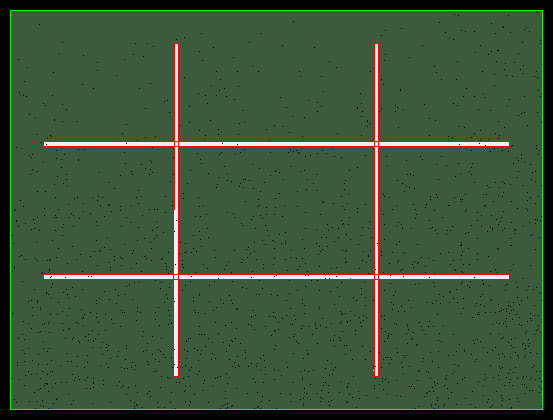

# 04 第 3 步：高度图

> 这一步把几百万个三维点压成一张**俯视高度图**（一张二维图像）。然后用图像处理把"凸起来的东西"分成两类：
>
> - **细条**：普通立板的顶面；
> - **宽区**：厚块、宽杆、抬高的平板、斜面。
>
> 下一步（第 4 步）在细条里找直线，在宽区里按高度分层。

代码：`tools/proto_v2.py` 第 65–107 行；高度图本身在 `tools/protolib.py` 第 231–241 行（`heightmap`）。

## 1. 为什么要变成图像

- 立板都是竖着的。从正上方看，一块立板就是一条**窄长条**，宽度 = 板厚。"找板"就变成了"在图里找窄长条"。
- 二维图像有很多现成、很快的工具：膨胀、腐蚀、连通域、骨架、轮廓，OpenCV 里都有。
- 数据量小：几百万个点变成几十万个像素。

代价是丢掉了细节：一个像素里只留一个高度。所以**第 5 步量尺寸时会回到原始点**，高度图只负责"分块"。

## 2. 像素选多大：自动选 px（第 66–93 行）

px 是高度图的分辨率：px = 1.0 表示一个像素是 1 mm × 1 mm。

**两难**：

- **点稀的云用小像素**：板条里一半像素是空的，掩膜碎成渣。SS30（俯视每 mm² 只有 0.47 个点）强制用 px = 1.0 时：
  - 骨架段从 87 条变成 386 条；
  - 实体从 13 个碎成 55 个；
  - 召回 / 精度从 86.0 / 96.4 掉到 83.4 / 95.9。
- **点密的云用大像素**：细节变粗，5 mm 厚的板在 2.5 mm 的像素下只剩 2 个像素宽。不过影响不大：F168 强制 px = 2.5 是 98.2 / 98.5，只比 px = 1.0 的 98.9 / 99.0 低一点。

所以要的是：**在掩膜不碎的前提下，像素尽量小。**

**怎么判断"碎不碎"**（`auto_px`，第 71–78 行）：

- occ(p) = 用边长 p 的像素铺满工件的 xy 平面，数一数有点的像素有几个（`occ_count`，第 66–68 行）。
- ratio(p) = occ(p) ÷ (4 × occ(2p))。

一个边长 2p 的大像素正好装 4 个边长 p 的小像素。点足够密时，大像素里的 4 个小像素都有点，ratio ≈ 1；点越稀，小像素里空的越多，ratio 越小。

从 1.0、1.5、2.0、2.5、3.0、4.0 mm 里从小到大试，ratio（保留 3 位小数）≥ 0.7 就用它；都不行就用 4.0。命令行 `--px` 大于 0 时，直接用指定的值。

实测：

| 点云 | ratio | 选中的 px |
|---|---|---|
| F168、F173、F455、WP、WP169、WP338 | ratio(1.0) 都 ≥ 0.93 | 1.0 |
| SS34 | ratio(1.0) = 0.547，ratio(1.5) = 0.785 | 1.5 |
| SS30 | ratio(1.0 / 1.5 / 2.0 / 2.5) = 0.373 / 0.472 / 0.589 / 0.701 | 2.5 |

SS30 的 0.701 正好压在门槛上。把网格起点挪一挪、坐标系转 180°，它会在 0.698 ~ 0.702 之间变（`tools/px_stability.py` 测的），也就是可能选到 3.0。不过 SS30 强制 px = 2.0 是 85.8 / 96.0，px = 3.0 是 86.0 / 96.3，结果都差不多。**这种"压线"不用担心，也不要为了凑某一个值去改门槛。**

想看任意一份点云的 ratio，可以用 `tools/px_probe.py`。

## 3. 画高度图（`tools/protolib.py` 第 231–241 行）

- 图的原点：x0 = 最小 x − 10·px，y0 = 最小 y − 10·px。也就是四周各留 10 个像素的空边，后面做膨胀、开闭运算时就不用操心"碰到图像边界怎么办"。
- 点 (x, y, z) 落在第 `col = ⌊(x − x0)/px⌋` 列、第 `row = ⌊(y − y0)/px⌋` 行。
- `hm[row, col]` = 落在这个像素里的**最高点**的 z；没有点的像素是 −1e9。
- `occ` = 这个像素有没有点。
- `base_vis` = 有底板时，这个像素里有没有 |z| < 2.5 mm 的点，也就是"这里看得到底板"。无底板时全是 0。

**为什么这里取最高点，而第 2 步的 10 mm 网格取 P95？** 10 mm 的格子里有几百个点，取百分位才有意义；1 mm 的像素里只有两三个点，没法取百分位。零星飞点造成的小凸起，会在下面"去小块"时去掉；而第 5 步量尺寸用的是原始点和稳健统计，不受影响。

`base_vis` 后面会用三次：

- 第 6 步：判断两段之间的缺口是真断开，还是被挡住；
- 第 9 步：画底板轮廓；
- 第 11 步：调试图里的深绿色。

## 4. 凸起区 raised（第 97–102 行）

先补几个图像处理的基本概念。"结构元"就是一个小模板，比如 3×3 的方块或者一个圆盘。

| 操作 | 做什么 | 效果 |
|---|---|---|
| 膨胀（dilate） | 每个值为 1 的像素都按结构元的形状往外"长胖" | 区域变大，小缝被填上 |
| 腐蚀（erode） | 结构元放不进去的地方都变成 0 | 区域变小，比结构元还细的东西消失 |
| 闭运算（close） | 先膨胀，再腐蚀 | 填上小缝、小洞，大体形状不变 |
| 开运算（open） | 先腐蚀，再膨胀 | 去掉比结构元细的部分，粗的部分形状不变 |
| 连通域 | 把连在一起的 1 像素编成一组 | 4 连通：只算上下左右相邻；8 连通：斜对角也算相邻 |

做法：

1. **找凸起**：
   - **有底板**：比底板顶面高 8 mm 以上（`hm > h_min`，`--h-min` 默认 8）的像素算凸起。底板本身的起伏和噪声远小于 8 mm。
   - **无底板**：有点的像素全算，因为看到的东西都属于工件。
2. **3×3 闭运算**：填上扫描线之间、点稀处的单像素缝。
3. **补小洞**（`fill_small_holes`，第 81–87 行）：把值为 0 的区域按 4 连通分块，面积 ≤ max(4, 40/px²) 像素（大约 40 mm²）的块填成 1。外面的大背景和 10 像素空边连在一起，面积很大，不会被填。
4. **去小块**：把值为 1 的区域按 8 连通分块，面积 < max(20, 150/px²) 像素（大约 150 mm²）的块删掉。飞点、碎屑就这样没了。

为什么阈值写成"数字 / px²"？因为它们本来是按 mm² 定的，换算成像素个数要除以 px²。外面再套一个 max，是为了 px 很大时下限不会只剩一两个像素。

## 5. 细条和宽区（第 103–104 行）

```
wide = raised 做开运算，结构元是直径约 24 mm 的圆盘（--w-thin 默认 24）
thin = raised 里，不在"wide 再往外膨胀 2 mm"之内的部分
```

- **开运算为什么能分开它们**：比圆盘窄的东西会被腐蚀掉，之后的膨胀也长不回来；比圆盘宽的东西先缩一圈再长回来，形状基本不变。
- **为什么是 24 mm**：立板一般 5 ~ 20 mm 厚，数据里最厚的立板是 19.5 mm。宽杆、厚块都比这宽，比如 SS34 的腹杆宽 28 ~ 44 mm，弦杆宽 62 mm。24 mm 正好卡在中间。
- **为什么要多膨胀 2 mm 再减**：开运算会把宽区的直角磨圆一点，边上也会留下零碎像素。这些"宽区的边角料"不属于 `wide`，如果直接算 thin = raised − wide，它们就会变成假的细条。先把 `wide` 往外扩 2 mm 再减，就把它们吃掉了。
- **已知问题**：细条紧贴着宽区时，可能被一起当成宽区，少出一块板（见 [13 踩坑记录与设计问答](13_pitfalls_faq.md)）。

最后算一个后面要用的数：

- `rho_top` = 总点数 ÷（有点的像素数 × px²），也就是**俯视每 mm² 有几个点**（第 105 行）。
- 第 8 步判断倾斜板时，要用它估计"一个斜面上应该有多少点"。

## 6. 看一看：S5_sparse_grid

合成样例 S5 模仿 SS30：

- 点间距 1.5 mm，比别的样例稀；
- 底板 10 mm 厚，而且底面也扫得到；
- 4 块筋板组成"井"字。

`out/bench/S5_sparse_grid/parts.json` 里（跑法见 [12 评测、合成样例与工具](12_eval_tools.md)）：

```json
 "heightmap": { "px": 1.5, "size": [553, 420], "occ_ratio": { "1.0": 0.444, "1.5": 0.99 }, "rho_top": 0.56 }
```

- ratio(1.0) = 0.444 < 0.7：1 mm 的像素一大半是空的，太碎；ratio(1.5) = 0.99，选 1.5。
- `rho_top` = 0.56，比 1 ÷ 1.5² ≈ 0.44 多一点，因为底面的点也算进去了。



- **黑色**：没有点的像素。即使用了 1.5 mm 的像素，底板上还有零星的小黑点；如果用 1 mm 的像素，就是一大片。
- **深绿**：看得到底板、又不算凸起的像素。
- **灰白**：其他有点的像素，越高越亮。4 条白带就是筋板顶面。
- **红框**：最后拟合出来的 4 块板（第 5 ~ 7 步的结果）。**外面的绿框**：底板轮廓（第 9 步）。

完整的颜色说明见 [10 输出文件详解](10_outputs.md)。

## 小结

- 高度图 = 每个像素取最高点；`occ` = 有没有点；`base_vis` = 看不看得到底板。
- 像素大小自动选：在"掩膜不碎"的前提下尽量小，用 ratio ≥ 0.7 判断。
- `raised`：有底板时是高于底板 8 mm 的地方，无底板时是所有有点的地方。然后闭运算、补小洞、去小块。
- 用直径 24 mm 的圆盘做开运算，把 `raised` 分成 `wide`（宽区）和 `thin`（细条）。

**想一想**：

1. 一块 30 mm 厚的立板比 24 mm 还厚，它会走哪条路？最后还能变成一块"板"吗？（提示：看下一章的"宽段"。）
2. 如果把 ratio 的门槛从 0.7 改成 0.71，SS30 会选哪个 px？结果大概会怎样？
3. 无底板时 `raised` 直接等于 `occ`。如果桁架下面的地面也被扫到了，会发生什么？

下一章：[05 第 4 步：骨架分段与宽区分层](05_segments.md)
