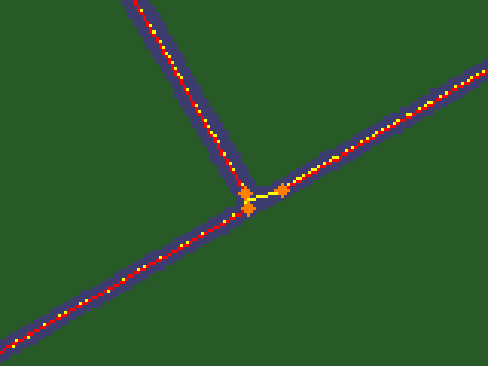
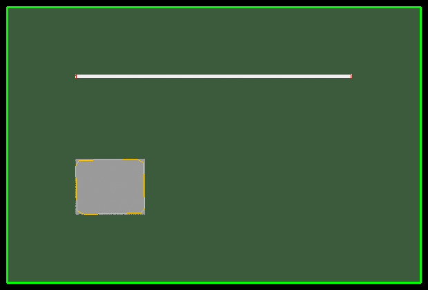

# 05 第 4 步：骨架分段与宽区分层

> 第 3 步得到了两张掩膜：`thin`（细条）和 `wide`（宽区）。这一步把它们变成一条条"段"（segment）：每段是一条直线，带一个粗略的宽度。
>
> - 细条 → 骨架 → 直线段（`src = "thin"`）；
> - 宽区 → 按高度分层 → 斜坡段（`"slope"`）、宽段（`"wide"`）、块（block）。
>
> 段只给出**大概**的位置、方向和宽度（宽度误差 1 ~ 2 mm），真正的尺寸在第 5 步量。

代码：`tools/proto_v2.py` 第 109–194 行；`tools/protolib.py` 第 249–297 行（`crossing_number`、`skeleton_segments`）。

## 1. 细条 → 直线段（`skeleton_segments`）

一块立板的顶面在 `thin` 里是一条窄带。要把它变成"一条直线 + 一个宽度"，分 4 步。

### 1.1 细化：求骨架

`cv2.ximgproc.thinning`（Zhang–Suen 算法）一圈一圈地剥掉区域边上的像素，但不会把区域剥断，直到只剩 1 像素宽的中线。这条中线叫**骨架**。

这个函数在 OpenCV 的扩展模块 ximgproc 里。所以 `requirements.txt` 里装的是 `opencv-contrib-python-headless`，不是普通的 `opencv-python`。

### 1.2 找分叉点：用 crossing number（`tools/protolib.py` 第 249–254 行）

骨架在两块板相交的地方会分叉（T 形、十字形）。先把分叉点找出来，才能把骨架拆成一根一根的"分支"。

做法：对骨架上的每个像素，按"上、右上、右、右下、下、左下、左、左上"的顺序，绕它的 8 个邻居走一圈，数一数从"空"跳到"骨架"几次。

- 线的中间：2 次（来的方向一次，去的方向一次）；
- 线的端点：1 次；
- 分叉点：3 次或更多。

**为什么不直接数邻居个数？** 斜线在像素图上是一级一级的"台阶"，台阶拐角处的像素也有 3 个邻居：

```
台阶拐角（不是分叉）        T 形分叉
    ■ □ □                    □ ■ □
    ■ ● □                    ■ ● ■
    □ ■ □                    □ □ □
邻居 3 个，跳变 2 次         邻居 3 个，跳变 3 次

● = 当前像素    ■ = 骨架上的邻居    □ = 空
```

左图里，"左上"和"左"两个邻居挨在一起，绕一圈只算一段，所以只跳 2 次。如果按邻居个数判，斜着走的板会被切成几十段短线。第一版原型（`tools/proto_rebuild.py`）就吃过这个亏。[14 练习](14_exercises.md) 里可以亲手试一下。

### 1.3 拆成分支（第 261–263 行）

把每个分叉点和它周围 3×3 的像素从骨架上挖掉，剩下的骨架按 8 连通分组，每组就是一根分支。

### 1.4 每根分支：排成链 → 断成直线 → 量宽度（第 264–296 行）

1. **太短的跳过**：分支的像素数 × px 不到 min_len 的一半。细条用的 min_len 是 20 mm。
2. **排成一条链**：从分支的端点（分支里邻居最少的像素）出发，每次走到一个没走过的邻居（先走上下左右，再走斜角），直到走不动为止。这样分支里的像素就有了先后顺序。
3. **换成 mm**：每个像素换成它中心点的 mm 坐标。
4. **用 Douglas–Peucker（DP）断折线**（`dp_split`，`tools/protolib.py` 第 45 行起），容差 max(2, 2·px) mm：
   - 连起折线的首尾两点，找离这条连线最远的点；
   - 最远距离 > 容差，就在这个点断开，两边各自重复这个过程；
   - 否则这一段就"够直了"。

   这样，一根拐了弯的分支（比如没有分叉点的 L 形板）会断成两段直线。
5. **每段（至少 3 个点）**：
   - 中心 `c` = 点的平均值；
   - 方向 `d` = 主方向。用的是 PCA：点的协方差矩阵最大特征值对应的特征向量，也就是点"散得最开"的方向；
   - `s0`、`s1` = 点在 `d` 方向上投影的最小值、最大值。长度不到 min_len 的丢掉。
6. **宽度** `w` = 2 ×（链上像素的距离变换值的中位数）× px。
   - 距离变换：掩膜里每个像素到最近的掩膜外像素的距离。在中线上，它正好是半个宽度。
   - 这个宽度很粗。S1 的两块板真厚 8 mm 和 10 mm，这里量出来是 10 和 12。所以第 5 步要重新量。

### 1.5 看图：S2 的交叉口



这张图用 `tools/dbg_skel.py` 画（1 像素 = 1 mm，又放大了 5 倍；怎么画见 [14 练习](14_exercises.md)）。颜色：

- 深绿：看得到底板；
- 暗蓝紫：细条掩膜 `thin`；
- 黄：骨架；
- 红：拆出来的直线段；橙色圆点：直线段的两个端点。

图里是合成样例 S2：

- 板 C：沿 30° 方向，从左下到右上；
- 板 D：垂直于 C，一头顶在 C 的侧面上。

骨架在交叉口被拆开，得到 3 段：C 被切成两半（长 244.2 和 237.0 mm），加上 D（194.0 mm）。

交叉口附近，骨架拐了个小弯，还有一小段黄线没有变成红线：它太短，被丢掉了。所以交叉口附近的段端点会差出将近 10 mm。这没关系：

- 第 6 步会把 C 的两半重新并起来；
- 第 7 步会用"D 和 C 的交线"重新算 D 的端点。

### 1.6 每个合成样例的原始段

把 `tools/proto_v2.py` 跑到第 4 步为止，打印 `segs`（方法见 [14 练习](14_exercises.md)），可以看到：

| 样例 | 原始段 | 说明 |
|---|---|---|
| S1_tee | 3 | 长板 A 被 B 切成两半（244.0、243.0），加上 B（172.0） |
| S2_oblique | 3 | 同上：C 的两半 + D |
| S5_sparse_grid | 12 | "井"字的 4 块板，每块都被另外两块切成 3 段 |
| S6_gap | 4 | 两条线上各有一个 100 mm 的缺口，各断成两段 |

S1 的原始段（和真值对比）：

| 段 | 长度 L | 骨架宽度 w | 方向 d | 真值 |
|---|---|---|---|---|
| A 左半 | 244.0 | 10.0 | (1, 0) | A：长 500、厚 8 |
| A 右半 | 243.0 | 10.0 | (1, 0) | |
| B | 172.0 | 12.0 | (0, 1) | B：长 176、厚 10 |

两半加起来比 500 短，是因为交叉口附近挖掉了一块，两头也各短一点：骨架总比真实的条带短。这些都会在第 5 ~ 7 步补回来。

## 2. 宽区 → 分层 → 斜坡段 / 宽段 / 块（第 114–192 行）

宽区里可能是：

- 厚块（F455 有 5 个）；
- 抬高的水平板（WP）；
- 宽杆（SS34 的弦杆和腹杆，宽 28 ~ 62 mm）；
- 倾斜板露出来的斜面（WP169 那块倾斜 19.6° 的斜板）。

办法是**先按高度分层，再按形状分**。

准备：第 3 步的闭运算补出来的像素是没有点的。`hm_fill`（第 129 行）给它们取周围 3×3 邻居里的最高高度。

然后对 `wide` 的每个 8 连通块分别处理。只在这个块的外接框里算，不用每次都扫整张图。

1. **分层**（第 132–148 行）：
   - 面积 < 400 mm² 的块跳过。
   - 块里所有像素的高度 hv，减去最小值，按 1 mm 一格做直方图，再把相邻 5 格加起来平滑。
   - 从最高的峰往下挑：峰高不到块面积的 12% 就停；和已经挑中的层相差 > 10 mm 才收。最后按高度排序。
   - 一个都没挑到时，用 hv 的中位数当唯一的层。
2. **归层**（第 149–151 行）：每个像素归到最近的层。离所有层都超过 10 mm 的像素记为 off：那里的高度是连续变化的，也就是**斜面**。
3. **斜坡段**（第 152–165 行，`src = "slope"`）：
   - off 像素做 3×3 开运算，按 8 连通分块；
   - 面积 ≥ 1500 mm² 的块，做 `skeleton_segments`（min_len = 40 mm）；
   - 只留"长度 ≥ max(60, 2w) 且条带填充率 ≥ 0.6"的段。

   斜坡段**不带层高**。它交给第 5 步拟合，再由第 8 步判断是不是倾斜板。
4. **每一层**（第 166–192 行）：这一层的像素（去掉 off）做 3×3 开运算，按 8 连通分块，面积 ≥ 400 mm² 的块逐个处理：
   - **宽段**（`src = "wide"`，带上层高 `level`）：做 `skeleton_segments`（min_len = 20 mm），只留"长度 ≥ 1.5w 且条带填充率 ≥ 0.8"的段，比如之字形的腹杆、长条垫板。每收一段，就在"已用"图 `acc` 上涂一个矩形：比段宽 4 mm，两头各长出 0.5w + 5。
   - **块**：剩下的部分（块减去 `acc`）再做 3×3 开运算，按 8 连通分块。面积 ≥ 400 mm² 的，取外轮廓，用 `simple_ring` 化简成一个不自交的多边形（容差 max(2, 2.5/px) 像素，细节见 [09](09_solids_output.md)），得到一个块：`{poly 多边形, top = 层高}`。

**条带填充率**（`strip_fill`，第 124–126 行）：把段的矩形（长 s0 ~ s1、宽 w）画到一张空图上，算矩形里的像素有多大比例落在掩膜里。

- 真的杆、条，会把自己的矩形填得满满的；
- 一团东西的骨架，比如方块的骨架是个"X"形，拆出来的段的矩形会伸出掩膜外面，填充率低，不算杆。

几个要点：

- "长度 ≥ 1.5w"：杆必须明显是长条。
- **块的顶 = 层高**（直方图的峰），不是最高点，所以不怕飞点。
- **块的底**：有底板时是 0；无底板时，取块的外接框里全部点高度的 1% 分位（第 10 步）。
- **为什么要分层**：块的顶、站在块上的板、抬高的平板，高度都不一样。每一层是一个平顶，正好对应一个棱柱。不属于任何层的像素就是斜面。

## 3. 对答案

**S3_truss_nobase**（无底板）：

- 一根弦杆（宽 60、顶高 85）横着，一根腹杆（宽 30、顶高 50）从它下面穿过去。两者都比 24 mm 宽，都在 `wide` 里，连成一个十字形的块。
- 分出两层：51.4 和 86.4。比真值高一点，因为层高来自"每个像素的最高点"。
- 弦杆那一层：1 个宽段（L 934.9、w 59.9）。
- 腹杆那一层被弦杆切成两块：2 个宽段（L 137.6、w 30.4，各一个）。
- 原始段一共 3 段。第 6 步把腹杆的两半并起来，最后是 2 块板，厚 59.98 和 29.77（真值 60 和 30）。
- 弦杆的骨架只有 935 mm 长（真长 1000）：矩形的骨架两头各短大约半个宽度。第 5 步会往两头多切一点，把长度量回 993.7。

**S4_lean**：

- 倾斜 10° 的板（顶高 120），从上往下看是一条约 31 mm 宽的带：顶面约 10 mm，加上露出来的斜面约 21 mm（120 × tan 10°）。它比 24 mm 宽，所以走的是宽区。
- 顶面那部分自成一层（119.4）→ 一个宽段（L 381、w 12）；斜面不属于任何层 → 一个斜坡段（L 367、w 18）。
- 再加上旁边的竖直板（细条），原始段一共 3 段。第 6 步把倾斜板的两段并成一块，第 8 步认出它是倾斜板。详见 [08](08_profile_lean.md)。

**S7_block**：

- 一个 100 × 80 mm、高 40 的厚块，加上一块 6 mm 的细立板。
- 厚块只有一层（40.26），里面拆不出合格的杆，整个变成 1 个块：多边形有 8 个顶点，顶高 40.3（真值 40）。



图里橙黄色的是块的轮廓，红色的是细立板，绿色的是底板轮廓。

注意块的四个角被切掉了一小块：第 3 步用直径约 24 mm 的圆盘做开运算，会把直角磨成半径约 12 mm 的圆角，`simple_ring` 化简时再用一条短边切掉。这是一个已知的小误差，S7 的分数仍然是 99.8 / 99.9。

## 小结

- 细条：骨架 → 用 crossing number 找分叉点 → 拆分支 → 排成链 → DP 断成直线 → PCA 定方向，距离变换估宽度。
- 宽区：按高度分层 → 不属于任何层的是斜坡段；每一层里，又长又满的是宽段，剩下的是块。
- 段的位置、方向、宽度都只是粗略值，交叉口附近的端点尤其不准。后面三步会修正它们。

**想一想**：

1. 一块 30 mm 厚、200 mm 长的立板会变成什么：宽段，还是块？
2. 宽段为什么要在 `acc` 上涂得比自己宽 4 mm，两头还各长出 0.5w + 5？
3. 方块的骨架为什么是"X"形？它拆出来的段为什么通不过"长度 ≥ 1.5w"？

下一章：[06 第 5 步：逐段切片拟合](06_slices.md)
