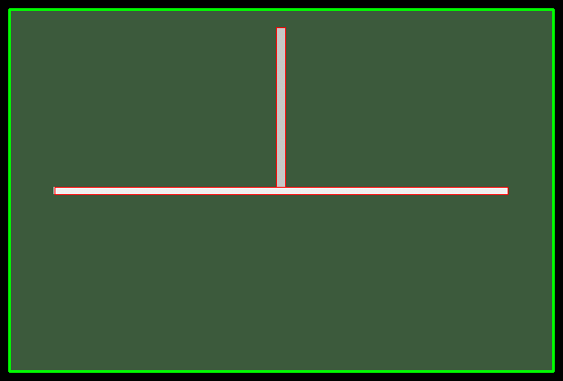
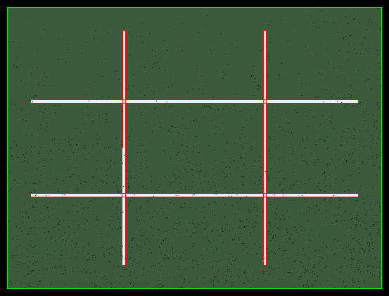

# 10 输出文件详解：parts.json、debug_top.png、model.step

> 读完这一章，你应该能回答：跑完一个点云，磁盘上多了哪几个文件？每个文件里有什么？调试图的颜色分别是什么意思？
> 代码位置：`tools/proto_v2.py` 第 567–598 行。

## 1. 跑一次产出什么

```
python -I tools/proto_v2.py data/synth/S1_tee.pcd out/S1_tee

out/S1_tee/
  model.step      输出模型（纯文本 STEP，转回原坐标）
  parts.json      中间结果日志 + 每个实体的参数（下面细说）
  debug_top.png   俯视调试图
```

屏幕上还会打印一行 JSON，是 `parts.json` 的摘要：

```json
{"has_base": true, "base_t": 20.0, "segs": 3, "fitted": 3, "merged": 2,
 "blobs": 0, "solids": 3, "step": 3, "total_s": 0.65, "t": {"read": 0.01, "frame": 0.21, ...}}
```

`segs → fitted → merged → solids` 这一串数就是流程的脉搏：第 4 步的骨架段，第 5 步拟合成功几块，第 6 步并成几块，最后出了几个实体。看它就能判断中间哪一步出了状况。

## 2. parts.json 的字段

| 键 | 含义 |
|---|---|
| `points` | 读进来的点数（去掉 NaN/Inf 后） |
| `up_tilt_from_sensor_deg` | 传感器 +Z 和真"上"的夹角 |
| `has_base`、`base_t`、`base_t_used` | 有没有底板；量出来的底板厚；实际用的（量不出就用 `--base-t`） |
| `heightmap` | 像素大小 `px`、图尺寸、占用率比值、`rho_top` |
| `raw_segments`、`blobs` | 第 4 步的段数、块数 |
| `fitted`、`merged` | 第 5 步拟合出的板数、第 6 步合并后的板数 |
| `lean` | 每块倾斜板的判定证据（内点数、倾角、rms、rel_dens …） |
| `lean_dups_dropped` | 删掉的影子板数 |
| `base_fill_rect` | 底板轮廓占最小外接矩形的比例 |
| `step_solids` | 写进 STEP 的实体数 |
| `time_s` | 每步用时（秒），键名对应关系见 [02 第 8 节](02_overview.md) |
| `solids` | 每个实体的参数（不含几何点）：`name`、`kind`、`t`、`L`、`top`、`lean_deg`、`prof_pts`、`slices`、`w_iqr` |

`solids` 的 `kind` 说明每块板从哪来：`strip_thin`（细条）、`strip_wide`（宽区里的长条）、`strip_slope`（斜坡带）、`lean_*`（倾斜板）、`block`、`base`。

## 3. debug_top.png 的颜色

俯视视角，背景是高度图（亮 = 高），叠加各结果：

| 颜色 | 含义 |
|---|---|
| 灰 | 高度图（每像素最高点的高度） |
| 深绿 | 看得到底板的像素（|z| < 2.5） |
| 红框 | 从细条来的板（`thin`） |
| 橙框 | 从宽区来的板（`wide`） |
| 品红框 | 从斜坡带来的板（`slope`，一般是倾斜板的影子） |
| 黄框 | 块（`block`） |
| 绿框 | 底板轮廓 |



S1 的图里：两条红框是两块立板，外面的绿框是底板轮廓。注意立板框的**宽**——俯视图里板只是一条窄带，窄带的宽度就是板厚；框的长边是板长。这张图是每跑一个点云都该先看一眼的"体检图"：板数对不对、方向对不对、底板轮廓合不合理，一眼就有数。



S5 是仿 SS30 的稀疏网格筋板（点距 1.5 mm）：两条横筋、两条竖筋、底板（绿框）。

## 4. 辅助检查工具

| 工具 | 干什么 |
|---|---|
| `tools/check_step.py model.step` | 用 OCCT 读回 STEP，逐个实体做有效性检查（BRepCheck），体积必须 > 0 |
| `tools/cmp_keys.py <a.json> <b.json>` | 对比两份 parts.json 的键结构，看两次运行的中间结果差在哪 |
| `tools/cmp_plates.py` | 按板对比两份 parts.json 的板参数 |
| `tools/stage_table.py` | 把 8 份点云各阶段的中间结果汇总成一张表 |
| `tools/dbg_base.py` / `tools/dbg_skel.py` | 画判底板 / 骨架的调试过程（第 14 章练习会用到） |

下一章：[11 参数说明](11_params.md)
