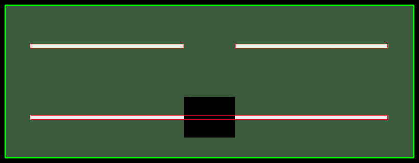

# 13 踩坑记录与设计问答

> 这一章收集做原型时真遇到过的坑，以及几个常被问到的设计问题。
> 每个坑都按 **现象 → 原因 → 原型里怎么做** 来写，并给出代码位置（行号对应仓库里现在的代码）。

## 读之前

- 文中的分数和点数，来自作者自己的 42 份点云（不在仓库里，没法直接复现）：
  - 8 份有参考模型：现场点云（真实扫描）F168、F173、F455、WP、WP169、WP338，仿真点云（用软件模拟扫描得到）SS30、SS34；
  - 34 份没有参考模型，都是仿真点云，名字以 SS、PC 开头。
- 合成样例 S1–S7 是 `tools/synth_gen.py` 生成的小样例，可以自己跑（见 [12 评估工具](12_eval_tools.md)）。
- 几个常用词：
  - **参考模型**：工件的设计模型，存成 STEP 文件（一种通用的三维 CAD 格式），用来给结果打分。
  - **召回 / 精度**：参考模型表面上，离输出不到 τ = 3 mm 的比例叫召回；反过来，输出表面上离参考不到 3 mm 的比例叫精度。文中写成"召回 / 精度"，单位是 %。
  - **found**：参考模型里有几块板算"找到了"（这块板一半以上的表面离输出不到 3 mm）。
  - **切片**：沿板的轴线每 5 mm 取一小段点，在这一段里量顶高和宽度。
  - **分位数 Pk**：把一组数从小到大排，排在 k% 位置的那个数。P50 就是中位数。
  - **凸包**：用橡皮筋把一组点箍起来，围成的那个凸多边形。

## 一、读入和数据（详见 [03 第 1–2 步](03_frame.md)）

**1. 压缩的 PCD 是按字段存的**
- 现象：SS34 这类 `binary_compressed` 的 PCD 文件（点云库 PCL 常用的点云格式），按"一个点接一个点"去解析，读出来的坐标全是乱的。
- 原因：这种格式先用 LZF（一种很简单的压缩算法）压缩；解压后是按字段存的：先是全部点的 x，再是全部 y，再是全部 z。
- 原型里：解压后按字段取（`tools/read_any_pcd.py` 第 28–33 行）。这个读取器能力有限，用之前心里要有数：

| 文件情况 | 结果 |
|---|---|
| `DATA binary` 或 `DATA binary_compressed` | 能读 |
| 除 x y z 外还有别的字段（如 rgb），每个字段 1 个数（COUNT 1） | 能读，x、y、z 按名字取 |
| 某个字段存多个数（COUNT > 1，比如 `normal` 一个字段存 3 个数） | **不报错，但坐标读错**：拼数据类型时没看 COUNT（第 23–25 行） |
| `DATA ascii`（文字格式） | 直接报错（第 34 行） |

现有数据都是 `x y z`、float32、COUNT 1，所以没出过问题。表里后两行是用手工造的小文件试出来的。

**2. 现在没有 NaN，不代表以后没有**
- 现象：现有 42 份点云都是 `HEIGHT 1` 的无序点云，一个 NaN（"不是一个数"）都没有；但有序点云（`HEIGHT` > 1）常用 NaN 给没测到的位置占位。
- 原因：一个 NaN 混进去，求和、均值、拟合的结果全会变成 NaN。
- 原型里：读取器不看 WIDTH / HEIGHT，有序点云也当成一串点读进来，也不管 NaN；读完马上把含 NaN / Inf 的点去掉（`tools/proto_v2.py` 第 56 行）。

**3. 文件里是 float32，计算要用 float64**
- 现象：用 float32 求和、求均值，误差能到毫米级。
- 原因：现场点云坐标能到 8700 mm，点有几百万个；float32 只有大约 7 位有效数字，越加误差越大。
- 原型里：读进来马上转成 float64（`tools/read_any_pcd.py` 第 26–27 行、第 28–33 行）。

## 二、坐标系和底板（详见 [03 第 1–2 步](03_frame.md)）

**4. 传感器的 Z 轴不是"上"**
- 现象：现场点云的底板相对传感器倾斜 0.23° ~ 1.31°（F168 最大，1 m 就差 23 mm）。
- 原因：直接拿传感器 Z 当高度，底板一头高一头低，"高出底板 8 mm 才算凸起"（`--h-min 8`）这个门槛就没用了。
- 原型里：先粗估上方向，再精修两遍（`tools/protolib.py` 第 134–141 行），最后的倾角记在日志里（第 142 行）。

**5. 底板不是理想平面**
- 现象：F455 的底板 4 m 长，拟合平面后残差的均方根（rms）有 1.22 mm。
- 原因：板这么大，本来就不会绝对平；飞点（测错的孤立点）和底板下表面的点，会把普通最小二乘拉偏，更会把"最低点"拉低。
- 原型里：用稳健平面定底板（3 轮"拟合 → 踢掉离群点 → 再拟合"，`tools/protolib.py` 第 35–42 行、第 192–210 行），z = 0 就定在这个面上。不要用普通最小二乘，更不要拿最低点当 z = 0。

**6. 仿真点云的底板下表面也有点**
- 现象：SS30（仿真点云）的 far = 0.214。far 是这一层俯视范围里、比它低 4 mm 以上的点所占的比例；按"底板下面不该有点"的想法，会判成无底板。
- 原因：仿真时底板的下表面也被"扫到"了。
- 原型里：看这些下方的点是不是集中在一个和底板平行、深 3 ~ 40 mm 的薄层里（`tools/protolib.py` 第 172–180 行）。是，就是底板下表面，顺便量出底板厚：SS30 量出 10.14 mm（参考 10 mm）。合成样例 S5 模拟了这种情况，量出 10.0 mm。

**7. "有没有底板"判错最致命**
- 现象：一旦判错，z = 0 在哪、板底在哪、"缺口里看不看得到底板"全跟着错。
- 原因：判据是几个比例和阈值（`tools/protolib.py` 第 183–188 行）：far < 0.03（或去掉底板下表面那一层后的 far_below_bottom < 0.03）；solidity > 0.3（这一层的面积占它自己凸包的比例）；hull_ratio > 0.3（这一层的凸包占整个工件凸包的比例）。离阈值很近的点云，一点点差别就会翻过去。
- 原型里：8 份有参考的点云都离阈值很远（far ≤ 0.009，或 far_below_bottom = 0 且 hull_ratio ≥ 0.81）。无参考的有 6 份很近：PC09、PC12、SS02 的 hull_ratio 是 0.29 ~ 0.30，SS14 是 0.32，SS15 的 far 是 0.029，SS23 的 far_below_bottom 是 0.032。自动判不准时，可以用 `--mode base` 或 `--mode nobase` 强制指定（第 189–190 行，参数见 [11](11_params.md)）。

**8. 方向向量的正负号要定规则**
- 现象：把骨架段方向 d 或长边方向 ex 反过来，再跑合成样例：板厚最多变了 0.4 mm（S1 里那块 10 mm 的板：9.63 → 10.03 mm）；反 ex 时，输出里板的先后顺序也变了。
- 原因：特征向量、最小外接矩形（能框住所有点的最小矩形，可以斜着放）给出的方向本来就不分正负。方向一反，像素网格的起点、切片从哪一端开始分，都跟着变。
- 原型里：上方向、底板法向都翻成朝上（`tools/protolib.py` 第 92–93 行、第 201–202 行），倾斜板侧面的法向也是（`tools/proto_v2.py` 第 425–426 行）。但 ex（`tools/protolib.py` 第 214–220 行）和 d（第 291 行）没定规则，直接用 OpenCV / numpy 给的结果；同一个库版本每次给的都一样，所以原型可复现。换语言、换库时要自己补规则。

## 三、高度图和分块（详见 [04 第 3 步](04_heightmap.md)、[05 第 4 步](05_segments.md)）

**9. 点稀的点云不能用 1 mm 像素**
- 现象：SS30 俯视每 mm² 只有 0.47 个点，1 mm 像素有一半是空的，掩膜（0/1 图，1 表示"这个像素属于某个区域"）碎成渣；强制用 1 mm 时，实体从 13 个碎成 55 个。
- 原因：像素比点距还小，板顶上到处是空洞。
- 原型里：按占用率自动选像素（`tools/proto_v2.py` 第 71–78 行）：在 1.0、1.5、2.0、2.5、3.0、4.0 mm 里从小到大试，第一个 ratio ≥ 0.7 的就用。ratio = 有点的小像素个数 ÷（4 × 有点的大一倍像素个数），点够密时接近 1。
- 注意：SS30 的 ratio(2.5) = 0.701，正好压在 0.7 上，网格起点挪一挪就在 0.698 ~ 0.702 之间变（`tools/px_stability.py` 能量这个）；它强制用 2.0、3.0 时分数也都达标。还有 12 份无参考点云，某一档的 ratio 在 0.685 ~ 0.715 之间。**不要为了某一份点云去改 0.7。**

**10. 找骨架分叉点要用跨越数，不能数邻居**
- 现象：一条 35°、宽 8 像素的斜线，细化（把条带削成 1 像素宽的"骨架"）后有 280 个骨架像素，其中 278 个有 ≥ 3 个邻居。按邻居数判分叉，一块斜板会被切成一堆碎段。
- 原因：斜线细化后是 8 连通（斜对角挨着也算连着）的台阶，台阶拐角处邻居多。
- 原型里：用跨越数（`tools/protolib.py` 第 249–254 行）：绕 8 个邻居转一圈，数"空 → 有"变了几次。1 是端点，2 是线中间，≥ 3 才是分叉（第 261 行）。上面那条线跨越数 ≥ 3 的一个都没有。30°、45° 的线两种方法都没问题，所以这个坑只在某些角度出现，很容易漏测。

**11. 简化出来的多边形会自交，检查工具还不一定查得出**
- 现象：块和底板的轮廓用 DP 算法（Douglas–Peucker：只保留拐弯明显的点）简化后，有时边和边相交（自交），或者一个顶点碰到别的边。最早的版本在 34 份无参考点云里有 7 份出了无效实体。SS24 更麻烦：用 OCCT（一个开源的 CAD 几何库）检查实体的 `tools/check_step.py` 检查通过了，多边形其实不合法。
- 原因：DP 只保证简化后离原轮廓不远，不保证还是"简单多边形"（不相邻的边互不接触）。
- 原型里：块的轮廓、不是矩形的底板轮廓，都走 `simple_ring`（`tools/protolib.py` 第 376–387 行，用在 `tools/proto_v2.py` 第 190 行和第 498–514 行）：先用容差 ε 简化，不合法就试 2ε、4ε，还不行就用凸包，并在 stderr 打一行 `ring_fix`。作者的数据里有 8 份点云、共 14 个块用上了退路（2ε 7 个、4ε 5 个、凸包 2 个）。

**12. 斜板会被宽区吞掉**
- 现象：WP169 的 #6 板倾斜 19.6°，俯视是一大片宽区（高度图上宽过 24 mm 的凸起，比如厚块、斜面；比它窄的叫细条，通常是立板的顶）。直接当"块"，会变成一个实心大块。
- 原因：斜板的斜面在高度图上又宽、高度又连续变，和厚块长得很像。
- 原型里：宽区先按高度分层（一层要占 ≥ 12% 的面积，层与层相差 > 10 mm，`tools/proto_v2.py` 第 140–148 行）；不在任何层上的"斜面像素"里，先找斜坡带（面积 ≥ 1500 mm²、够长、填充率 ≥ 0.6，第 151–165 行），剩下的才做块。

**13. 贴着宽区的细条会被吞掉（还没解决）**
- 现象：无参考的 PC09（角钢座）只出了水平肢一个块，竖肢（约 260 × 175 mm 的竖板）没出来。
- 原因：竖肢的顶在俯视图里是一条贴着水平肢的细条，和水平肢连成一片，被当成了宽区。竖肢顶只有 527 个像素（约 1190 mm²），高度散在 150 ~ 180 mm，占不到 12%，成不了一层；归到斜面像素后，又不够斜坡带要的 1500 mm²，就被丢了。
- 原型里：没解决。改进方向：宽区分层之前，先把明显高出周围的细条分出来，交给骨架和切片处理。

**14. 块的顶用层高，不用最高点**
- 现象：块的顶如果取最高点，会被飞点、焊缝抬高。
- 原因：最高的那几个点往往是噪声。
- 原型里：块的顶 = 它所在层的高度（`tools/proto_v2.py` 第 191–192 行），有底板时块的底 = 0。弱项：F455 的 #4、#9、#20 是俯视很小却很高的块和立柱（高 114 ~ 160 mm；#9 俯视只有 15 × 24 mm，比最小块面积 400 mm² 还小，第 133 行），参考里 #9、#20 各有 10 个面（带斜面或缺口）。原型用"俯视多边形 × 高度"近似，这三块的召回只有 0.45、0.23、0.36。

## 四、切片和拼板（详见 [06 第 5 步](06_slices.md)、[07 第 6–7 步](07_merge_junctions.md)）

**15. 不能按固定的 X / Y 方向切片**
- 现象：板可以朝任何方向（合成样例 S2 有一块 30° 的板）。按固定方向切，斜着的板量不准；顺着板切，片里只有一条线，根本量不出厚度。
- 原因：板厚是垂直于板面方向的宽度。
- 原型里：切片垂直于每块板自己的轴线（`tools/proto_v2.py` 第 201–205 行取点，第 208–259 行量尺寸）。

**16. 不能把整块板的点放在一起量宽度**
- 现象：方向偏 0.5°，400 mm 长的板两端横向就错开 3.5 mm，量出来的厚度就多 3.5 mm。
- 原因：方向上的小误差，被板长放大了。
- 原型里：每 5 mm 一片单独量，再取中位数（`tools/proto_v2.py` 第 229–251 行）：
  - 片的顶高取 P95（第 230 行）；比顶高低不到 4 mm 的点算顶面条带（第 235 行）；
  - 宽度 = 条带横向 P2.5 到 P97.5 这一段 ÷ 0.95（这一段只占全宽的 95%），各片取中位数（第 236、250–251 行）；
  - 轴线用各片条带的中心重新拟合，最多 3 轮（第 220–249 行）。

**17. 被挡断的板要接起来，真断开的不能接**
- 现象：合成样例 S6 里，板 E 中间有 100 mm 没数据（被挡住了），应该接成 1 块；F1、F2 之间是一道真缝，缝里露出了底板，应该是 2 块。
- 原因：两种情况在高度图上看都是"断开"。
- 原型里：先看方向（夹角 < 4°）、横向错位和宽度比（`tools/proto_v2.py` 第 284–290 行），再看缺口里"看得到底板"的比例（第 268–274 行）。缺口 > 400 mm 不接；缺口 > 15 mm 且看得到底板的比例 > 0.3 也不接（第 294 行）。S6 跑出来是一块 698 mm 的板加两块 298 mm 的板，符合预期。

**18. 合并、接头、去重都会删板，别靠下标找板**
- 现象：合并时删掉一块板，后面所有板在列表里的位置（下标）都变了；事先记下的下标，会指到别的板上。
- 原因：合并（`tools/proto_v2.py` 第 299 行的 `pop`）、接头之后去掉太短的板（第 337 行）、倾斜板去重（第 494 行）都会删板。
- 原型里：用对象本身做记号（Python 的 `id(p)`）：第 299 行记下哪些板合并过，第 303–308 行按记号重新拟合；第 494 行按记号删掉重复的板。

**19. 接头是按顺序就地改的**
- 现象：两块板夹角 > 20° 时，要把板端推到另一块板的侧面上，或者穿过去（`tools/proto_v2.py` 第 314–336 行）。改一下处理顺序，板端位置就可能变。
- 原因：板端是直接在列表里改的；后处理的板 A 要用到板 B 的 s0、s1（板沿轴线的起止位置，第 323、333 行），看到的是 B 已经被前面改过的值。
- 原型里：按列表顺序一块一块改，"顶到侧面"还是"穿过去"看第 333–335 行。

**20. 互相穿过的板不切断**
- 现象：井字形的筋板（合成样例 S5、仿真点云 SS30）在交叉处互相穿过。
- 原因：如果在交叉处把窄板切断，一块板会变成好几块，实体数变多。
- 原型里：顶边剖面（板顶的高低轮廓）跳过交叉区（`tools/proto_v2.py` 第 345–355 行），板保持整块。

**21. 取板上的点，用的是一串圆，不是矩形**
- 现象：看名字 `strip_points` 像是取一个长条矩形里的点，其实是沿轴线一串圆里的点（`tools/proto_v2.py` 第 201–205 行，用 `query_ball_point`），两端会多出半个圆的点。
- 原因：这是实现上的选择，但后面有步骤依赖它：倾斜板只在 s0 + 5 到 s1 − 5 之间取点（第 412 行），板长靠这些点沿轴线的 P0.3 ~ P99.7 定（第 453–454 行），两端多出来的那点点正好补上。
- 原型里：照原样用圆。换成矩形，倾斜板的长度就会变。

**22. 厚度有系统偏差，不要调参去"修正"**
- 现象：SS30 的筋板，量出来比参考厚约 1.3 mm；合成样例 S5（板厚 8 mm）量出来 6.49 ~ 7.78 mm，薄了 0.2 ~ 1.5 mm。
- 原因：SS30 偏厚，作者的判断是焊缝和混合像素（落在板边上、一半板一半背景的点）让顶面看起来更宽；S5 偏薄，是因为点距 1.5 mm，8 mm 宽的顶面横向只有 5 ~ 6 个点。
- 原型里：照实输出，不加补偿。

## 五、倾斜板（详见 [08 第 8 步](08_profile_lean.md)）

**23. 不要用横切片判倾斜**
- 现象：在每一片里量侧面倾角，会量出"假倾斜"。做原型时试过这种做法，后来放弃了；仓库里的探针工具 `tools/slice_probe.py` 还保留着每片量倾角的写法，可以拿来对比。
- 原因：一片里的顶面条带只有 4 mm 高，看不出斜不斜；片里的侧面点，又常常是斜着扫到的竖直面。
- 原型里：把板上看得到的那个侧面整个拿来，用 RANSAC 拟合平面（随机抽几个点拟合、数有多少点贴得上，重复多次取最好的那个，`tools/proto_v2.py` 第 380–401 行），在 `lean_check`（第 404–461 行）里判断。

**24. 斜着扫到的竖直面会冒充倾斜面**
- 现象：竖直板的侧面被斜着扫到一些点，拟合出来也像一个斜面。
- 原因：朝扫描仪倾斜 θ（偏离竖直的角度）的面，单位面积的点数约是水平面的 sin θ 倍；斜着扫到的竖直面，点数远低于这个值。
- 原型里：算这个侧面的相对点密度 rel_dens（侧面上每 mm² 的点数 ÷ 整份点云俯视每 mm² 的点数，`tools/proto_v2.py` 第 438 行），要求 ≥ 0.8 × sin θ（第 439 行），倾角还要 ≥ `--lean-min`（默认 3°，第 441 行）。代码注释记的实测值：假倾斜 ≤ 0.07，真倾斜 ≥ 0.11（第 437 行）。

**25. 倾斜板的斜面会被重复认成一块矮板**
- 现象：斜面在俯视图里也是一条细条或宽段，第 4 步已经把它当成一块竖板了，结果和倾斜板重叠。
- 原因：同一个斜面，被两条路各认了一次。
- 原型里：倾斜板做完后去重（`tools/proto_v2.py` 第 477–494 行）：方向差不到 10°、顶不比倾斜板高出 5 mm 以上、顶面中点落在倾斜板板体里的那块板，删掉。

另外，无参考的 SS02 出了 2 块倾斜板（3.01°、4.26°），其实是两段宽约 92 ~ 105 mm 的宽段被判成了倾斜，很可能是误判。3.01° 刚好压在 3° 的门槛上；原型没有专门处理。

## 六、输出和评分（详见 [09 第 9–11 步](09_solids_output.md)、[10 输出文件](10_outputs.md)、[12 评估工具](12_eval_tools.md)）

**26. WP 的分数上不去，不要为它调参**
- 现象：WP 的召回 / 精度只有 75.5 / 77.0（10 块板找到 8 块），是 8 份有参考点云里最低的。
- 原因：参考模型和点云本身就对不齐。整份点云只有 77.9% 的点落在参考 3 mm 以内（其余 7 份是 93.9% ~ 99.4%）。用 `tools/ref_offset.py` 逐面量"点云到参考面的距离"：最大的两块长立板 #4、#6 看得到的那个侧面，点云和参考差 3.0、2.1 mm（同一个方向），#0 差 2.0 mm；其余的面大多在 1 mm 以内（同样的量法放到 WP169 上，面也大多在 1 mm 以内）。原型的板面贴着点云走，所以离参考 2 ~ 3.6 mm（`tools/cmp_plates.py` 量的），偏过 3 mm 的部分就算没找到（#4 的召回只有 0.50）。另外 #0 的板厚量成 12.2 mm（参考 15.5 mm）；参考里还有 1 个体积为 0 的坏实体，谁也找不到，所以 found 最多 9/10。
- 原型里：不为它改参数。

**27. parts.json 的键名别随便改**
- 现象：改了键名不会报错，只是汇总表里那一栏变成空值，很难发现。
- 原因：`tools/run_bench.py`、`tools/stage_table.py` 直接按键名读 `parts.json`（比如 `has_base`、`heightmap`、`solids`），用的是 `.get()`，读不到就当没有。
- 原型里：键名固定。要比较两份 `parts.json` 的键结构（比如移植后的版本和原型），用 `tools/cmp_keys.py`：第一份里有、第二份里没有的键算错误；第二份多出来的键只列出来。

**28. 输出要逐字节可复现**
- 现象：同一份输入跑两次，`model.step` 只要有一个字节不同，就没法用哈希（文件内容的"指纹"）判断"结果有没有变"。
- 原因：数字格式、实体编号、遍历顺序、文件头里的时间，任何一个不固定，输出就会变。
- 原型里：`tools/step_writer.py` 的数字用固定格式（第 36–38 行），实体编号按顺序递增（第 41–46 行），文件头时间写死（第 125–127 行），只用 ASCII 字符和 `\n` 换行（第 128 行）。`tools/run_bench.py` 可以指定一份点云跑两次、比较两次的哈希（第 126–132 行）。实测：合成样例 S2、S4 各跑两次，`model.step` 完全一样，`parts.json` 除了用时也完全一样。

## 七、设计问答

**问 1：在俯视高度图上对应的位置做多次切面，是不是更好的建模方法？**

是，原型就是这么做的，要点有两个。一是**切面要垂直于每块板自己的轴线**，不能按固定的 X / Y 切（坑 15）：板的方向由高度图的骨架给出，再沿轴线每 5 mm 切一片，量顶高、顶面宽（= 板厚）、顶面中心。二是**俯视图负责"分"，切片负责"量"**：哪里有板、板朝哪走，看俯视图最清楚；板多厚、多高、中心线在哪，看切片最准（每片取分位数抗噪，再对几十上百片取中位数）。只用俯视图，厚度受像素大小限制（1 ~ 2.5 mm 一格）；只用切片，又不知道该往哪个方向切。

切片也有不擅长的事：倾斜板改用侧面直接拟合平面（坑 23、24）；两块板交接处，切片会同时切到两块板，所以板端用两块板中面的交线来定（见 [07](07_merge_junctions.md)）。

**问 2：有底板、没底板，真能用同一套方法吗？**

能。整条流程只有两处不同：z = 0 定在哪（有底板时是底板顶面；没有时是全部点高度的 P0.5，也就是工件最低处附近，`tools/protolib.py` 第 223–224 行），板底在哪（有底板时是 0；没有时是这块板条带里点高度的 P1，`tools/proto_v2.py` 第 253–254 行）。其余步骤代码一样：没有底板时，"缺口里看得到底板"的比例自然是 0（第 268–274 行），底板轮廓这一步直接跳过。证据：

- 无底板的 SS34：召回 / 精度 98.3 / 98.0，12 块参考板全找到。
- 合成样例 S3（无底板，两根杆上下交叉）：判成无底板；下面那根杆被上面的挡成两段，又接回了 1 块。
- 34 份无参考点云（20 份有底板、14 份无底板）全部跑通，实体全部有效。

做得还不好的：没有底板的 H 型钢（PC13 ~ PC16），上翼缘被做成从翼缘顶一直通到下翼缘的块（厚约 240 mm，实际翼缘只有 10 ~ 20 mm）。原因不在"有没有底板"，而在块：无底板时块的底 = 块的外接框里全部点高度的 P1（`tools/proto_v2.py` 第 552–556 行），框里有下翼缘的点；而块只看俯视图，不知道中间是空的。

**问 3：为什么看不到的面不去"找"，而是用"可见面 + 板厚"补？**

从上往下扫，一块竖板通常只扫得到顶面和一个侧面；另一个侧面、根部、底板下表面都看不到（F173 的侧面点只占 1.2%）。去找看不到的面只能靠猜，不如用顶面量出板厚，再平移一个板厚得到另一面。这样每块板都是"平面多边形 × 厚度"，一定是封闭的实体，面数也和参考模型差不多（8 份合计：原型 1314 个面，参考模型 1601 个）。

**问 4：为什么不把板布尔合并成一个整体？**

布尔运算（求并、求差这类实体运算）慢，还容易失败：两个面共面或相切时，OCCT 这样成熟的几何库也会出错。而且合并以后，评分程序就没法按块比较了。所以每块板单独一个实体；需要整体模型时，在 CAD 软件里合并也很快。

**问 5：为什么像素大小要自动选，不能固定一个值？**

- 固定 1 mm：SS30 点稀，掩膜会碎，实测实体从 13 个碎成 55 个，找到的参考板从 25 块掉到 22 块。
- 固定 2.5 mm：F168 实测 98.2 / 98.5，比 1 mm 的 98.9 / 99.0 只低一点；但 5 mm 厚的板只剩 2 个像素宽，细节变粗，没必要。

自动规则（坑 9）看"小像素里有多少是空的"：不碎就用小像素，碎了才换大的。8 份有参考的点云里，现场点云都选到 1.0 mm，SS30 选到 2.5 mm，SS34 选到 1.5 mm；合成样例 S5（点距 1.5 mm）也选到 1.5 mm。

**问 6：原型为什么不用 OCCT 生成实体？**

OCCT（Open CASCADE，一个开源的 CAD 几何内核，能造实体、做布尔运算、读写 STEP）功能很强，但原型用不着：
- 每块板都是平面多边形拉伸出来的棱柱，STEP 里只需要平面、直线和多边形环，直接按格式写文本就行（`tools/step_writer.py`）。
- 原型的核心只依赖 numpy、scipy 和 opencv-contrib（细化要用 contrib 版里的 `cv2.ximgproc.thinning`），见 `requirements.txt`。装起来简单，输出也好做到逐字节可复现（坑 28）。
- OCCT（通过它的 Python 绑定 OCP）只在检查和评分工具里用，比如 `tools/check_step.py`、`tools/eval_recon.py`。

## 八、如果你想把它移植到别的语言

原型可以当作移植（比如移植到 C++）的参考实现。下面这些地方最容易让结果对不上：

1. **全程用双精度**（坑 3）：读进来就转 double，求和、均值、协方差都用 double 累加。
2. **方向的正负号自己定规则**（坑 8）：上方向和各种法向，照原型一律翻成朝上；ex、d 这类水平方向也定一条规则（比如让 x 分量 ≥ 0）。规则和 numpy / OpenCV 碰巧给的不一样时，结果会和原型差一点点（上面的实验里板厚最多差 0.4 mm），这是正常的。
3. **按对象删板、按原顺序改接头**（坑 18、19）：给每块板一个固定编号，记编号，不记它在数组里的位置；接头按同样的列表顺序就地改，后处理的板要看到前面已经改过的端点。
4. **直方图选峰要定"平局"规则**：高度分层按直方图从多到少挑（`tools/protolib.py` 第 150 行、`tools/proto_v2.py` 第 142 行，都用 `np.argsort(-hist)`）。两个格子点数一样多时谁排前面，numpy 默认的排序并不保证；自己定一条（比如高度低的先），否则可能分出不同的层。
5. **随机种子固定，但别指望抽到同样的点**：原型里几处随机抽样都固定了种子（上方向 RANSAC 和底板抽样用 0，最小外接矩形抽样用 1，倾斜板 RANSAC 用 0；`tools/protolib.py` 第 70–94、192–220 行，`tools/proto_v2.py` 第 380–401 行）。换一种语言，随机数生成器不同，抽到的点也不同；自己的版本要固定种子保证可复现，和原型比较时留一点误差。
6. **分位数的算法要对上**：切片里用的 `bin_pct`（`tools/proto_v2.py` 第 43–52 行）直接取排好序后第 ⌊(n−1)·k/100⌋ 个数，不插值；其他地方用 `np.percentile`，默认在两个数之间按比例插值。两种结果会有一点差别，每一处要用对应的那一种。
7. **输出顺序要固定**（坑 28）：不要用哈希表（比如 C++ 的 `unordered_map`）的遍历顺序来决定输出顺序。
8. **OpenCV 的算子要找等价实现**：细化（`cv2.ximgproc.thinning`，默认用 Zhang–Suen 算法）、最小外接矩形、凸包、形态学开运算。换一种实现，像素级的结果可能不一样。

怎么验证：先用 `tools/synth_gen.py` 生成合成样例 S1–S7（每个都带一份标准答案 STEP），两边都跑一遍；再拿 `parts.json` 里的中间结果（`has_base`、像素大小、每块板的厚度和长度等）逐项对比，键结构用 `tools/cmp_keys.py` 查。具体用法见 [12 评估工具](12_eval_tools.md)，动手练习见 [14 练习](14_exercises.md)。
