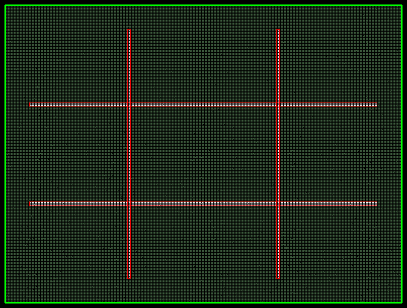
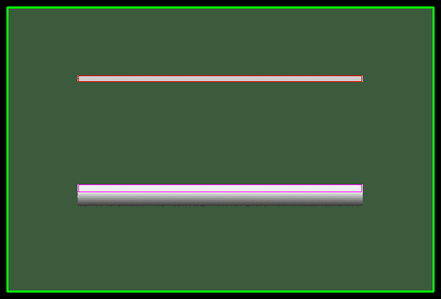
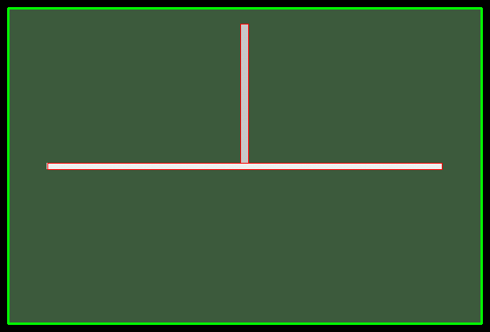
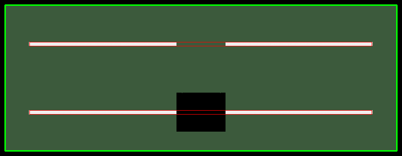
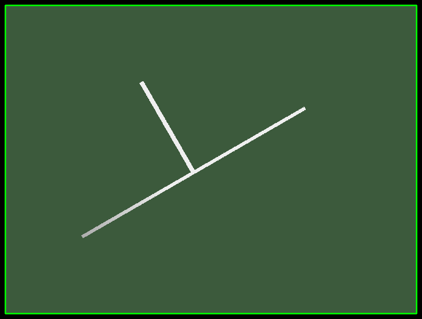
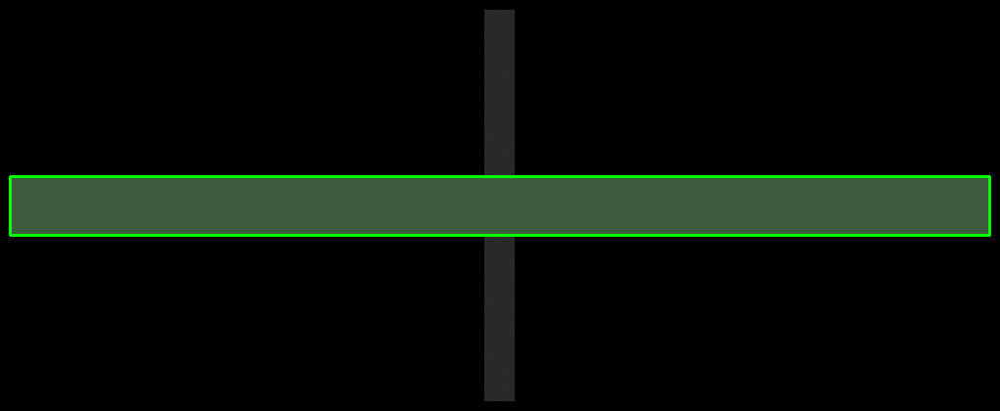

# 14 练习：7 个动手实验

> 读完这一章，你应该能回答：程序里每个关键设计到底"值多少分"——把某一处改坏，分数会掉多少、为什么掉。每个实验都有命令、结果和解释，全部在合成样例上做，几分钟跑完。

准备（生成样例、装依赖，见 [README](../README.md)）：

```
python -I tools/synth_gen.py data/synth
```

实验用的评分命令统一是：

```
python -I tools/eval_recon.py --ocp <OCP目录> --cloud data/synth/SX.pcd --ref data/synth/SX.step --out out/ex/.../model.step --json out/ex/.../eval.json
```

下面每个实验只给出关键结论，命令照抄模式改样例名即可。

## E1 稀疏点云：把像素强压回 1.0 有用吗？

`S5_sparse_grid`（点距 1.5 mm）默认自动选 px = 1.5。强行 `--px 1.0`：

| | R | P | found | fitted → merged | 板厚（真值 8） |
|---|---|---|---|---|---|
| 默认 px 1.5 | 100.0 | 100.0 | 5/5 | 12 → 4 | 6.50 / 6.49 / 7.78 / 6.49 |
| 强制 px 1.0 | 100.0 | 100.0 | 5/5 | 12 → 4 | 6.50 / 6.49 / 7.78 / 6.49 |

**结果一模一样。** 两个发现：

1. **像素再小，板厚还是偏薄 1.5 mm**。这不是像素问题，是点距问题：最靠边的点平均落在真边缘内侧约半个点距（0.75 mm），两边一减正好 1.5。像素放小不会凭空变出更靠边的点。
2. **中间碎了没关系**：px 1.0 时 12 段骨架段（自动的 1.5 也是 12 段），但第 6 步合并之后都是 4 块板。碎片会被合并收回来——这就是为什么第 3 步选像素的标准是"掩膜别碎成渣"，而不是"越细越好"。



## E2 倾斜板按竖直板建模：`--lean-min 90`

把 `S4_lean`（10° 斜板）的倾斜判定整个关掉：

| | R | P | found | 偏差 p95 |
|---|---|---|---|---|
| 默认 | 100.0 | 100.0 | 3/3 | — |
| `--lean-min 90` | 90.4 | 90.7 | 2/3 | 6.8 mm |

斜板被当成竖直板：顶面位置对了，但侧面斜出去了，板身两侧各差半个"斜度"造成的偏移，整块板大部分面积落在 3 mm 阈值外。**斜板必须按斜板建模**，竖直板化救不了。



## E3 底板厚猜错：`--base-t 10`

`S1_tee` 的底板真厚 20，底面看不到（现场云常态）。故意用 `--base-t 10`：

| | R | P | found | 偏差 p95 |
|---|---|---|---|---|
| 默认（20） | 100.0 | 100.0 | 3/3 | — |
| `--base-t 10` | 61.6 | 63.4 | 3/3 | 10.1 mm |

底板下表面整体往上挪了 10 mm，而底板是面积最大的零件——分数直接崩掉 30 多分。**底板厚是全局参数里最贵的一个**：现场云量不出真值，默认 20 mm 是对这批焊接件最稳的猜测；仿真云能量出来就用实测值（S5 的 10 mm 底板就是量出来的）。



## E4 拆掉"缺口看底板"检查：真缺口会被并掉

把第 6 步的合并门槛改掉（`tools/proto_v2.py` 第 294 行，`gap_has_base(...) > 0.3` 改成 `> 1.1`，即永远不因"缺口里看得到底板"而不并）：

| | R | P | found | 板 |
|---|---|---|---|---|
| 默认 | 100.0 | 100.0 | 4/4 | E 698.4；F1 298.2；F2 298.2 |
| 改掉检查 | 100.0 | 98.4 | 4/4 | E 698.4；**F1+F2 并成 698.4** |

S6 里 F1、F2 是**两块板**，中间 100 mm 真缺口里全是底板；E 板上的 100 mm 是**无数据阴影**，缺口里看不到底板。拆掉检查后，F1 和 F2 被并成一块 698.4 的长板，中间多填了 100 mm × 8 mm 的一条"假板"——召回没掉（参考里的面都还在），**精度掉 1.6 分**（多出来的假面）。这就是第 7 章那条门槛的价值：召回和精度不是一回事。



## E5 分叉用"邻居个数"判：骨架碎成 37 段

把 `tools/protolib.py` 第 261 行的分叉判定从 `crossing_number(sk) >= 3` 改成邻居个数 `nbr >= 3`：

| | R | P | found | 输出 |
|---|---|---|---|---|
| 默认 | 100.0 | 100.0 | 3/3 | 3 个实体 |
| 邻居数判分叉 | 88.0 | 100.0 | 1/3 | **只剩底板** |

斜线在像素图上是台阶，台阶拐角处的骨架像素有 3 个邻居——于是整个 30° 斜板沿线全是"分叉点"，被切成 37 段短线（最长 11 像素），全部过不了最短长度门槛，板全丢。**crossing number（绕 8 邻域一圈数 0→1 跳变）不把台阶拐角当分叉**，正是它存在的理由。



## E6 把骨架画出来看：dbg_skel.py

`tools/dbg_skel.py` 把细条掩膜、骨架、分叉点和断成的段画在一起（1 像素 = 1 mm，放大 5 倍）：

```
python -I tools/dbg_skel.py data/synth/S2_oblique.pcd out/S2_skel.png 293 268 453 388
```

最后四个数是裁剪窗口（列、行、宽、高，像素）。截的是 S2 的 T 形交叉口：


- 白点 = 骨架像素，品红 = 交叉点，橙 = 分支端点，绿/红/蓝 = 断出来的各段；
- 注意**只有一个交叉点**（品红），斜板的台阶拐角没有被误判——这就是 crossing number 的效果（对照 E5）。

## E7 强制"有底板"：`--mode base`

对无底板的 `S3_truss_nobase` 强制按有底板处理：

| | R | P | found | 输出 |
|---|---|---|---|---|
| 默认（auto） | 97.2 | 97.7 | 2/2 | 弦杆 + 腹杆 |
| `--mode base` | 29.6 | 66.8 | 0/2 | 只剩一块"底板" |

找不到候选层时强制模式会退化成无底板，但 S3 的最低层被误当成底板：坐标系、z = 0、凸起掩膜全错，两块杆件全丢。**判错有没有底板是最严重的错误**——比板厚猜错还贵（对照 E3）。`--mode` 只该在自动判定"差一点"的时候用（第 13 章列了哪些云离阈值近）。



## 做完之后

七个实验合起来是一张"设计值多少分"的账单：

| 实验 | 动的手脚 | 掉的分数 |
|---|---|---|
| E1 | 像素压小 | 0（碎片被合并收回） |
| E2 | 斜板竖直化 | R/P 各 −10，found −1 |
| E3 | 底板厚猜错 10 mm | R −38、P −37 |
| E4 | 拆掉缺口检查 | P −1.6 |
| E5 | 分叉判错 | found −2（板全丢） |
| E7 | 强制有底板 | R −68，found −2 |

改任何一处之前，先想清楚它防的是哪种输入；改完先跑 `tools/synth_bench.py`，再跑这个练习里对应的实验。每处设计的价值都在数字里。

回看：[12 评测、合成样例与工具](12_eval_tools.md) · [13 踩坑记录与设计问答](13_pitfalls_faq.md)
